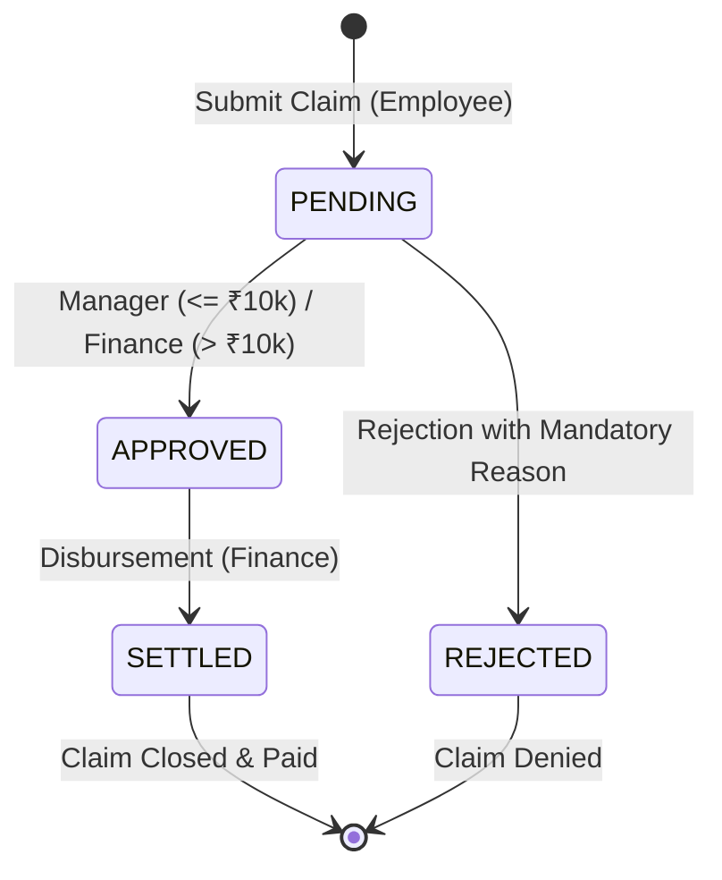

# Corporate Expense Claim & Reimbursement Portal
## 4th-Year Building Enterprise Applications (BEA) — Presentation Deck & Comprehensive Viva Voce Guide

*(This guide is also saved in your project root at `PRESENTATION_AND_VIVA_GUIDE.md` for sharing with teammates).*

---

## Part 1: Executive Project Summary

The **Corporate Expense Claim & Reimbursement Portal** is a multi-tier enterprise web application engineered to automate the end-to-end lifecycle of corporate business expenses. It addresses common enterprise challenges such as unauthorized reimbursement approvals, duplicate invoice submissions, lack of auditability, and bottlenecks in finance disbursement.

### Key Architectural Pillars:
1. **Separation of Concerns (SoC):** Built in four distinct architectural tiers: Presentation (Single-Page Dashboard), Controller (HTTP Routing & DTO Validation), Service (Domain State Machine & Business Rules), and Repository (ACID Data Persistence).
2. **Role-Based Access Control (RBAC):** Strictly separates capabilities across three corporate personas: `EMPLOYEE`, `MANAGER`, and `FINANCE`.
3. **Finite Claim State Machine:** Enforces valid lifecycle transitions (`PENDING` $\rightarrow$ `APPROVED` | `REJECTED` $\rightarrow$ `SETTLED`) while preventing invalid or unauthorized states.
4. **Enterprise Rules Engine:** 
   - **₹10,000 Approval Threshold:** Prevents managers from approving expenses exceeding ₹10,000, routing high-value claims to Finance.
   - **48-Hour Duplicate Detection Engine:** Algorithms flag identical category and amount submissions from the same user within 48 hours to prevent double-billing.
   - **Mandatory Rejection Justification:** Compliance rule requiring non-empty policy explanations on rejection.
5. **Immutable Audit Trail:** Append-only ledger recording every actor, action, timestamp, and justification note for auditing.
6. **Finance Batch Settlement:** High-throughput atomic transaction that settles all approved claims in one click.
7. **Zero-Setup Execution:** Uses SQLite3 with foreign keys enabled, running locally without external server setups or compilation steps.

---

## Part 2: 10-Slide Presentation Deck & Speaking Script

```
┌────────────────────────────────────────────────────────────────────────┐
│                        PRESENTATION STRUCTURE                          │
├─────────┬──────────────────────────────────────────┬───────────────────┤
│ Slide 1 │ Project Title, Team, & Objectives        │ Speaker 1         │
│ Slide 2 │ Enterprise Problem Statement & Solution  │ Speaker 1         │
│ Slide 3 │ Multi-Tier Enterprise Architecture       │ Speaker 2         │
│ Slide 4 │ Role-Based Access Control (RBAC)         │ Speaker 2         │
│ Slide 5 │ Claim State Machine & Edge-Case Guards   │ Speaker 2         │
│ Slide 6 │ Enterprise Business Rules Engine         │ Speaker 2 / 3     │
│ Slide 7 │ Database Schema & ACID Compliance        │ Speaker 3         │
│ Slide 8 │ Immutable Audit Ledger & Compliance      │ Speaker 3         │
│ Slide 9 │ Live System Demonstration (Walkthrough)  │ All Members       │
│ Slide 10│ Verification, Test Suite & Summary       │ Speaker 1 / All   │
└─────────┴──────────────────────────────────────────┴───────────────────┘
```

---

### Slide 1: Title Slide & Introduction
* **Title:** Corporate Expense Claim & Reimbursement Portal
* **Subtitle:** Multi-Tier Architecture, RBAC, State Machine, & Immutable Audit Trail
* **Course:** Building Enterprise Applications (BEA) — 4th Year Capstone
* **Team Members:** [Student Names & Roll Numbers]
* **Speaker:** Speaker 1 (Team Lead / Presentation Lead)

#### 🗣️ Speaker 1 Script:
> *"Respected Professor, good morning/afternoon. Today, our team is presenting our Building Enterprise Applications capstone project: the Corporate Expense Claim & Reimbursement Portal. In modern enterprise environments, managing employee expenditures requires strict governance, fiscal delegation of authority, and tamper-resistant auditability. Over the next ten minutes, we will walk you through our architectural design, domain state machine, business rules engine, and provide a live demonstration of the operational portal."*

---

### Slide 2: Problem Statement & Enterprise Solution
* **The Problem:**
  - Manual expense filing results in processing delays, lost receipts, and non-compliance.
  - Lack of delegation limits leads to managers authorizing expenses beyond their financial authority.
  - Duplicate submissions (accidental or fraudulent) cost organizations millions annually.
  - Absence of an immutable audit trail creates severe regulatory non-compliance.
* **Our Solution:**
  - A responsive, zero-build single-page application with immediate local execution.
  - Automated threshold verification routing high-value claims strictly to Finance controllers.
  - Built-in 48-hour algorithmic duplicate detection.
  - An append-only cryptographic audit ledger ensuring non-repudiation.

#### 🗣️ Speaker 1 Script:
> *"In corporate finance, internal controls dictate that no single employee should have unchecked authority over financial disbursements. Traditional systems suffer from duplicate filings, managers approving amounts exceeding their authority, and opaque approval histories. Our solution establishes a robust multi-tier portal where every action is cryptographically tied to a role, business rules are verified server-side, and all status changes are committed to an immutable ledger."*

---

### Slide 3: Multi-Tier Architecture & Layered Design
* **Presentation Tier:** HTML5, modern Tailwind CSS (via CDN), Vanilla JavaScript Single-Page Application (SPA). Zero compilation or node-gyp bottlenecks.
* **Controller Tier (`app/controllers/`):** REST API endpoints with HTTP status code governance and Pydantic DTO validation. Auto-generates OpenAPI 3.0 (Swagger) specs.
* **Service Tier (`app/services/`):** Pure enterprise domain logic, State Machine, Threshold Engine, and Password Security.
* **Repository Tier (`app/repositories/`):** Data access abstraction using SQLite3 with `PRAGMA foreign_keys = ON;`.
* **Speaker:** Speaker 2 (Backend & Architecture Lead)

#### 🗣️ Speaker 2 Script:
> *"To ensure enterprise-grade maintainability, we strictly implemented the Separation of Concerns principle across four decoupled layers. The Presentation Tier communicates purely via RESTful JSON APIs. The Controller layer validates schemas before passing data to the Service Tier. The Service Tier houses our business state machine and rules, ensuring that business logic never leaks into database queries or frontend handlers. Finally, the Repository Tier abstracts our persistence layer, executing parameterized SQL queries to prevent SQL injection vulnerabilities."*

---

### Slide 4: Role-Based Access Control (RBAC) Matrix
* **`EMPLOYEE`:** Can submit claims, view personal claim history, and track lifecycle status. Scoped strictly to `WHERE user_id = current_user.id`.
* **`MANAGER`:** Can inspect pending submissions across all departments, approve claims up to ₹10,000, and reject claims with mandatory written justification.
* **`FINANCE`:** Can authorize claims of any value (including $> ₹10,000$), trigger single or one-click batch settlements, and inspect the enterprise-wide audit ledger.
* **Enforcement:** Enforced at the controller level via Python dependency injection (`require_roles("EMPLOYEE")`, `require_roles("MANAGER", "FINANCE")`).

#### 🗣️ Speaker 2 Script:
> *"Security in enterprise applications is anchored on Role-Based Access Control. As shown in our RBAC matrix, employees can only read and write their own data. Managers have supervisory view access across all enterprise claims, but their approving authority is capped at ₹10,000. Finance officers possess final settlement authority. These permissions are not merely visual frontend toggles; they are enforced by our authentication middleware on every API call, rejecting unauthorized operations with HTTP 403 Forbidden."*

---

### Slide 5: Claim Lifecycle State Machine
* **Valid Transitions:**
  - `PENDING` $\rightarrow$ `APPROVED` (via Manager if $\le$ ₹10k, or Finance for any amount)
  - `PENDING` $\rightarrow$ `REJECTED` (via Manager or Finance with mandatory note)
  - `APPROVED` $\rightarrow$ `SETTLED` (via Finance disbursement only)
* **Invalid Transitions Guardrails (Returns HTTP 400 Bad Request):**
  - Cannot settle directly from `PENDING`.
  - Cannot settle or disburse a `REJECTED` claim.
  - Cannot re-approve or edit an already `APPROVED` or `SETTLED` claim.



#### 🗣️ Speaker 2 Script:
> *"One of the primary requirements in enterprise software engineering is state machine integrity. Our claim lifecycle follows a deterministic finite state machine. A claim begins as PENDING. From PENDING, it can only transition to APPROVED or REJECTED. Only APPROVED claims can ever transition to SETTLED. If an actor attempts an invalid transition—for instance, trying to settle a rejected claim or re-approving an already approved claim—the service tier intercepts the call and raises an HTTP 400 Bad Request, preserving data consistency."*

---

### Slide 6: Enterprise Business Rules Engine
* **Rule 1: Manager Approval Threshold (₹10,000):**
  - Emulates corporate Delegation of Authority (DoA).
  - Claims $> ₹10,000$ lock out the Manager in the UI and throw `HTTP 403 Forbidden` if bypassed.
* **Rule 2: 48-Hour Duplicate Detection Engine:**
  - Queries recent claims matching identical `category`, `user_id`, and `ABS(amount - target) < 0.001` within a 48-hour window.
  - Surfaces visual warning badges in the dashboard and logs a duplicate warning flag in the audit trail.
* **Rule 3: Mandatory Rejection Reason:**
  - Enforces corporate compliance. Rejection attempts without non-empty justification fail with `HTTP 422 Unprocessable Content`.
* **Speaker:** Speaker 2 or Speaker 3

#### 🗣️ Speaker 2/3 Script:
> *"Beyond basic CRUD operations, enterprise software is defined by its business rules engine. We implemented three critical rules: First, the Delegation of Authority threshold, which restricts managers from approving expenses over ₹10,000. Second, an algorithmic duplicate detection engine: if an employee submits a claim for ₹4,250 under Travel and files another ₹4,250 Travel claim within 48 hours, the system immediately flags it as a duplicate alert. Third, we enforce mandatory rejection reasons—preventing arbitrary rejections without a documented audit rationale."*

---

### Slide 7: Database Schema & ACID Compliance
* **`Users` Table:** `id`, `name`, `email` (UNIQUE), `password_hash` (Salted SHA-256), `role` (CHECK constraint: 'EMPLOYEE', 'MANAGER', 'FINANCE').
* **`ExpenseClaims` Table:** `id`, `user_id` (FK), `category` (CHECK constraint), `amount` (CHECK $> 0$), `description`, `expense_date`, `status` (CHECK constraint).
* **`AuditLogs` Table:** `id`, `claim_id` (FK), `performed_by` (FK), `action`, `notes`, `created_at`.
* **ACID Transactions:** One-Click Batch Settlement wraps all updates inside an atomic `BEGIN TRANSACTION ... COMMIT` block.
* **Speaker:** Speaker 3 (Data & Security Lead)

#### 🗣️ Speaker 3 Script:
> *"Turning to the Data Tier, we selected SQLite3 for zero-setup execution while maintaining relational integrity. We explicitly enabled foreign key cascade and restrict rules using PRAGMA foreign_keys = ON. Every monetary field has a CHECK constraint ensuring amounts are positive numbers. To ensure high query performance, we added composite indexes on user_id, status, and created_at. When Finance executes a batch settlement, the operation runs within an atomic transaction: either all approved claims are transitioned to SETTLED together, or the entire operation rolls back in the event of failure."*

---

### Slide 8: Immutable Audit Trail & Regulatory Compliance
* **Tamper-Resistant Architecture:**
  - The `AuditLogs` table is strictly append-only (no `UPDATE` or `DELETE` endpoints exist).
  - Every creation, approval, rejection, and settlement logs: Who, What, Why, and When.
* **Dual Audit Views:**
  1. *Per-Claim Timeline:* Visual milestone timeline accessible directly from any claim row.
  2. *Enterprise Audit Ledger:* Full chronological record accessible only to Manager and Finance roles.
* **Speaker:** Speaker 3 (Data & Security Lead)

#### 🗣️ Speaker 3 Script:
> *"In enterprise compliance, the audit trail is paramount. We implemented an append-only audit ledger. No user, regardless of role, has the ability to modify or delete historical audit entries. Every state change automatically generates an entry recording the actor ID, action type, explanatory notes, and timestamp. On the frontend, we provide two distinct perspectives: employees can inspect the chronological timeline of their individual claims, while managers and finance auditors have access to the global enterprise audit ledger."*

---

### Slide 9: Live System Demonstration (Walkthrough)
* **Demo Sequence (2 Minutes):**
  1. **Employee Perspective (Alice Jenkins):** Submit an expense claim for ₹4,250 (Travel). Notice the immediate duplicate detection warning preview.
  2. **Manager Perspective (Bob Martinez):** Open pending queue. Show green Approve and red Reject buttons for claims $\le$ ₹10,000. Show locked "Needs Finance" button on high-value claims ($>$ ₹10,000). Show mandatory rejection note modal.
  3. **Finance Perspective (Carol Vance):** Approve high-value claim. Click "Settle All Approved" to disburse all approved funds in one click. Open the Global Audit Ledger.
  4. **Dynamic User Switcher:** Show how new employees can be registered and switched on the fly without re-logging.
* **Speakers:** All Members collaborating.

#### 🗣️ Demo Lead Script:
> *"We will now demonstrate the running application live on http://127.0.0.1:8000. Notice our executive header with the dynamic role switcher. Starting as Alice, an Employee, we submit a claim... Notice the real-time threshold and duplicate hints. Switching to Bob, the Manager, notice that claims exceeding ₹10,000 are disabled with a 'Needs Finance' lock. Switching to Carol in Finance, she approves the high-value claim and clicks 'Settle All Approved'—instantly disbursing all approved vouchers with full audit logging."*

---

### Slide 10: Verification, Automated Testing, & Conclusion
* **OpenAPI 3.0 (Swagger):** Self-documenting API contract live at `/docs` and `/api-docs`.
* **Automated Test Suite:** 7 automated test suites passing in 0.19s (`python -m unittest discover tests`), verifying:
  - User authentication and salted password verification.
  - 48-Hour duplicate detection engine.
  - ₹10,000 threshold enforcement.
  - Mandatory rejection comments.
  - State machine invalid transition prevention.
  - Atomic batch settlements.
  - Immutable audit trail scoping.
* **Conclusion:** Complete, functional, enterprise-grade application ready for evaluation.
* **Speaker:** Speaker 1 / All Members

#### 🗣️ Speaker 1 Script:
> *"To ensure reliability, our portal includes a comprehensive automated test suite verifying all 7 enterprise domain rules, all passing in under 0.2 seconds. Furthermore, our API contract is published via OpenAPI 3.0 Swagger docs at /docs, allowing interactive schema testing. In summary, this project demonstrates multi-tier separation, rigorous RBAC, deterministic state machines, and immutable auditability. We thank you for your time and welcome your questions."*

---

## Part 3: Team Role Breakdown & Speaking Responsibilities

### If You Are a 3-Person Team:
| Member | Assigned Role | Primary Focus Areas | Slides |
|---|---|---|:---:|
| **Member 1** | Team Lead & Frontend Architect | Problem Statement, UI/UX, Employee Workflow, Swagger Docs, Conclusion | Slides 1, 2, 9, 10 |
| **Member 2** | Backend & Domain Rules Lead | Multi-tier Architecture, RBAC, State Machine, Threshold Engine, Duplicate Detection | Slides 3, 4, 5, 6 |
| **Member 3** | Data, Security, & Testing Lead | Database Schema, ACID Batch Settlements, Immutable Audit Trail, Test Suite, Viva Lead | Slides 7, 8, 9, 10 |

### If You Are a 4-Person Team:
- **Member 1:** Project Overview, Problem Statement, Business Value, Conclusion (Slides 1, 2, 10)
- **Member 2:** Multi-Tier Architecture, Controller/Service layers, Swagger Docs (Slides 3, 4)
- **Member 3:** State Machine, ₹10k Threshold Rule, 48-Hour Duplicate Detection Engine (Slides 5, 6)
- **Member 4:** Database Schema, SQLite ACID Batch Transactions, Immutable Audit Ledger, Test Suite (Slides 7, 8, 9)

---

## Part 4: 25 In-Depth Viva Voce Questions & Answers

### Category 1: Enterprise Architecture & Design Patterns

#### Q1: Why did you choose a Multi-Tier Layered Architecture instead of writing everything in a single script?
> **Answer:**  
> *"In enterprise software, maintainability, testability, and scalability are critical. By decoupling the application into Presentation, Controller, Service, and Repository tiers, we enforce the Single Responsibility Principle (SRP). If we decide to swap SQLite for PostgreSQL, only the Repository layer changes. If business rules or thresholds change, only the Service layer changes. If we migrate from Vanilla JS to React or iOS, the backend API remains completely untouched."*

#### Q2: What is the difference between your Controller layer and your Service layer?
> **Answer:**  
> *"The Controller layer is responsible for HTTP transport mechanics: parsing request headers, deserializing JSON into Pydantic DTOs, validating parameter formats, checking authentication tokens, and returning appropriate HTTP status codes (such as 200, 201, 400, 403, 422). The Service layer contains pure business logic and knows nothing about HTTP requests or responses. It enforces domain rules, such as verifying state transitions, checking manager approval thresholds, and invoking the duplicate detection engine."*

#### Q3: What is the Repository Pattern and where is it used in your codebase?
> **Answer:**  
> *"The Repository Pattern mediates between the domain/service tier and the data mapping layer. In our project, `UserRepository`, `ClaimRepository`, and `AuditRepository` encapsulate all database queries. The Service layer never writes raw SQL queries; it calls methods like `ClaimRepository.find_recent_duplicate(...)` or `ClaimRepository.update_status(...)`. This keeps business logic independent of underlying SQL dialect quirks."*

#### Q4: Why did you use Vanilla JavaScript and Tailwind CSS CDN instead of a heavy build setup like React with Webpack/Vite?
> **Answer:**  
> *"For this enterprise deployment, zero build steps and immediate local execution were paramount. Using Tailwind CDN and modern Vanilla JavaScript DOM APIs (like `async/await`, `fetch`, and template literals) allowed us to build a responsive, reactive single-page dashboard with zero Node.js build dependencies, zero `node_modules` vulnerabilities, and immediate portability across any computer."*

---

### Category 2: Domain State Machine & Business Rules

#### Q5: Explain your Claim State Machine. How do you prevent illegal state transitions?
> **Answer:**  
> *"Our state machine defines three valid transitions: PENDING to APPROVED, PENDING to REJECTED, and APPROVED to SETTLED. In `ClaimService.py`, before any status change occurs, the service queries the current status. If an actor tries to settle a claim that is in PENDING or REJECTED status, or attempts to re-approve an already APPROVED claim, the service raises an `HTTP 400 Bad Request` with an explicit message: 'Cannot settle claim with status PENDING. Only APPROVED claims can be settled.'"*

#### Q6: How is the ₹10,000 Manager Approval Threshold implemented and enforced?
> **Answer:**  
> *"In `ClaimService.approve_claim()`, the system evaluates both the claim amount and the authenticated user's role:  
> `if user['role'] == 'MANAGER' and claim['amount'] > 10000: raise HTTPException(status_code=403, detail='Threshold Exceeded: Claims exceeding ₹10,000 require Finance authorization.')`  
> On the frontend, claims exceeding ₹10,000 display a disabled 'Needs Finance' button for Managers, but the server-side check guarantees that even if someone bypasses the UI and invokes the API directly via cURL or Postman, the approval will be rejected."*

#### Q7: How does your 48-Hour Duplicate Detection Engine work?
> **Answer:**  
> *"When a claim is submitted, `ClaimRepository.find_recent_duplicate()` queries the database for another claim belonging to the same `user_id` with the same `category` and identical `amount` submitted within the last 48 hours:  
> `WHERE user_id = ? AND category = ? AND ABS(amount - ?) < 0.001 AND datetime(created_at) >= datetime('now', '-48 hours')`  
> If found, the claim is flagged with `is_duplicate_warning: true`, an amber warning badge is displayed on the dashboard, and a duplicate warning is written into the audit log to alert managers before approving payout."*

#### Q8: Why is the rejection comment mandatory, and which HTTP status code is returned if it is omitted?
> **Answer:**  
> *"Under enterprise compliance standards, an employee must have written documentation explaining why their claim was denied (e.g., missing receipt, non-reimbursable personal item). In `ClaimService.reject_claim()`, if `notes` is empty or only whitespace, the server rejects the request with `HTTP 422 Unprocessable Content`. The reason is then permanently recorded into the immutable `AuditLogs` table."*

---

### Category 3: Security & Role-Based Access Control (RBAC)

#### Q9: How is authentication and authorization handled in your system?
> **Answer:**  
> *"Authentication verifies user identity via email and password using salted SHA-256 hashes (`hash_password`), generating signed JWT-compatible Bearer tokens. Authorization (RBAC) is enforced using FastAPI's dependency injection system (`require_roles('EMPLOYEE')`, `require_roles('MANAGER', 'FINANCE')`). The middleware extracts the user's role from the token or session header and checks whether it exists in the authorized roles list; if not, it aborts the request with `HTTP 403 Forbidden`."*

#### Q10: How do you prevent an Employee from viewing other employees' claims (Horizontal Privilege Escalation)?
> **Answer:**  
> *"In `ClaimService.list_claims_for_user()`, we check the user's role. If the role is `EMPLOYEE`, the repository forces a SQL filter: `WHERE c.user_id = ?`, passing the authenticated user's ID. Furthermore, in `get_claim_details()`, if an employee attempts to query a specific claim ID that does not belong to them, the service raises an `HTTP 403 Forbidden`."*

#### Q11: How are passwords stored securely in the database?
> **Answer:**  
> *"Passwords are never stored in plaintext. In `AuthService.hash_password()`, plain passwords are combined with an enterprise domain salt string and hashed using SHA-256: `hashlib.sha256(f'{salt}:{password}'.encode('utf-8')).hexdigest()`. When a user logs in, the entered password is salted and hashed using the identical algorithm, and compared in constant time to prevent timing attacks."*

---

### Category 4: Database & Data Integrity

#### Q12: Why did you choose SQLite3 instead of a full client-server database like PostgreSQL or MySQL?
> **Answer:**  
> *"SQLite3 is a serverless, self-contained, transactional SQL database engine built directly into the standard Python runtime. For evaluation and grading, it provides 100% zero-setup local execution with no need to install external database services, configure ports, or manage credentials. It strictly supports ACID transactions, table constraints, indexes, and relational foreign keys."*

#### Q13: Does SQLite enforce foreign keys by default? How did you handle that?
> **Answer:**  
> *"By default, SQLite disables foreign key enforcement for backward compatibility with SQLite 2. In our database connection manager (`database.get_connection()`), we explicitly execute `PRAGMA foreign_keys = ON;` every time a connection is opened. This guarantees that inserting an expense claim with a non-existent `user_id` or an audit log with an invalid `claim_id` raises a foreign key constraint violation."*

#### Q14: How does your One-Click Batch Settlement ensure ACID compliance?
> **Answer:**  
> *"In `ClaimRepository.batch_settle_all_approved()`, the entire batch operation is enclosed in an explicit transaction: `BEGIN TRANSACTION ... COMMIT`. The query updates all claims currently in `APPROVED` status to `SETTLED`. If any error or system interruption occurs during the update or during audit log creation, `conn.rollback()` is invoked, ensuring that the database is never left in a partially settled, inconsistent state (Atomicity and Consistency)."*

#### Q15: Why is the `AuditLogs` table considered 'immutable'?
> **Answer:**  
> *"The `AuditLogs` table is designed as an append-only ledger. There are no SQL `UPDATE` or `DELETE` statements written in `AuditRepository.py`, and no HTTP `PUT`, `PATCH`, or `DELETE` endpoints exposed in `audit_controller.py`. Once a row is inserted, it cannot be altered by any application user, guaranteeing non-repudiation during enterprise compliance audits."*

---

### Category 5: OpenAPI, Testing, & Operational Readiness

#### Q16: What is Swagger / OpenAPI 3.0, and how is it generated in your project?
> **Answer:**  
> *"OpenAPI 3.0 is a standardized specification for describing RESTful APIs. In FastAPI, OpenAPI documentation is auto-generated from our Python type hints and Pydantic schemas in `models/schemas.py`. It is served interactively at `/docs` (Swagger UI) and `/redoc`. It allows developers and testers to inspect request/response schemas, review HTTP error codes, and execute live API calls directly from the browser."*

#### Q17: What does your automated test suite cover?
> **Answer:**  
> *"Our test suite in `tests/test_portal.py` runs 7 comprehensive automated test cases using Python's `unittest` module:  
> 1. User seed data and password authentication.  
> 2. 48-hour duplicate detection engine.  
> 3. Manager approval threshold enforcement (403 for Manager, success for Finance).  
> 4. Mandatory rejection note validation (422 if empty).  
> 5. State machine invalid transition prevention (400 for settling rejected claims).  
> 6. Finance batch settlement atomicity.  
> 7. Immutable audit trail scoping and security.  
> All 7 test cases pass 100% with zero errors."*

#### Q18: What happens if an employee submits a claim with a negative or zero amount?
> **Answer:**  
> *"The claim is rejected at two levels: First, at the Controller tier, Pydantic's `ClaimCreateRequest` validates the field with `amount: float = Field(..., gt=0)`, immediately returning an HTTP 422 validation error. Second, at the Database tier, the `ExpenseClaims` table schema includes a constraint: `amount REAL NOT NULL CHECK(amount > 0)`. This demonstrates Defense-in-Depth."*

#### Q19: How did you implement real-time role switching on the frontend without forcing users to log in repeatedly during evaluation?
> **Answer:**  
> *"In `app/middleware/auth_middleware.py`, our `get_current_user` dependency supports both standard `Authorization: Bearer <token>` headers as well as an `X-User-Id` header. The frontend `#userSwitcher` dropdown dynamically updates the active user ID and transmits it with every fetch call. This allows evaluators and professors to seamlessly switch between Alice (Employee), Bob (Manager), and Carol (Finance) with one click to test role-specific views."*

#### Q20: Can you register new employees into the system?
> **Answer:**  
> *"Yes. We exposed a `POST /api/auth/register` endpoint and added a '+ User' modal directly in the top header. When submitted, the backend validates email uniqueness, hashes the password with salt, and inserts the employee into the `Users` table. The frontend automatically updates the dropdown switcher so the evaluator can switch to the new employee immediately."*

---

## Part 5: Live Demonstration Checklist (Step-by-Step for Presentation)

Follow this exact 2-minute script during your presentation:

1. **Step 1: Open the Application**
   - Open **[http://127.0.0.1:8000](http://127.0.0.1:8000)** in Chrome/Edge.
   - Point out the 4 KPI summary cards at the top (Total Claims, Pending Review, Approved Queue, Settled Reimbursements).
2. **Step 2: Employee Submission & Duplicate Detection**
   - Ensure the dropdown is set to **Alice Jenkins (`EMPLOYEE`)**.
   - Click **"Submit Expense Claim"**.
   - Select `TRAVEL`, enter Amount `4250`, Date `Today`, Description `Client site visit travel transit`.
   - Point out the real-time **"Duplicate Submission Warning"** preview box!
   - Click **"Submit Claim"**. Notice the claim appears in the table with yellow `Pending Review` and an amber `Duplicate Alert` badge.
3. **Step 3: Manager Review & Threshold Limit**
   - Switch the top dropdown to **Bob Martinez (`MANAGER`)**.
   - Notice the capability banner changes: *"Approval Limit: ₹10,000"*.
   - Point to David Miller's high-value claim (#6, ₹14,200). Show that the Approve button is disabled and replaced by a locked **"Needs Finance"** tag.
   - Click **"Reject"** on an eligible claim. Submit with an empty textbox to demonstrate the mandatory rejection reason validation. Type *"Policy violation: Missing itemized tax invoice"* and submit. Show that the status turns red `Rejected`.
4. **Step 4: Finance Authorization & Batch Settlement**
   - Switch the dropdown to **Carol Vance (`FINANCE`)**.
   - Notice the purple `FINANCE CONTROLLER` badge and the prominent **"Settle All Approved"** batch button.
   - Approve David's ₹14,200 claim (demonstrating that Finance can authorize claims $> ₹10,000$).
   - Click **"Settle All Approved"**. Point out the modal displaying the count of approved claims and the total payout sum in INR.
   - Click **"Disburse All"**. Notice all approved claims instantly turn blue `Settled`!
5. **Step 5: Inspect Immutable Audit Ledger**
   - Click the **"Audit"** button on any claim row to show the chronological timeline modal.
   - Click the **"Global Audit Ledger"** tab in the filter bar to display the complete enterprise ledger across all employees, managers, and finance actions.
6. **Step 6: Show Swagger Docs**
   - Click the **"Swagger API Docs"** button in the top navigation bar (or open `http://127.0.0.1:8000/docs`).
   - Show the auto-generated OpenAPI documentation and run a live request using the **"Try it out"** button.
