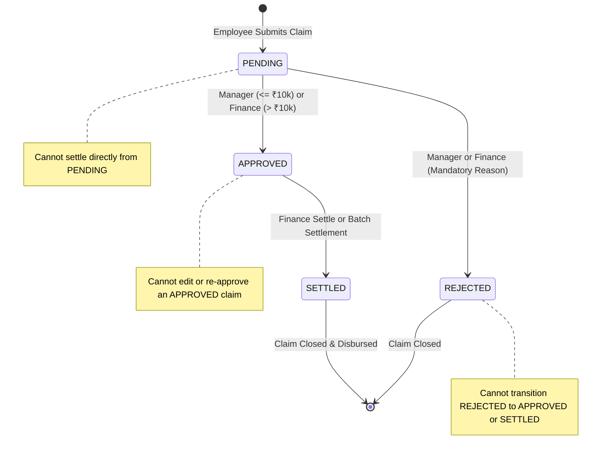

# Corporate Expense Claim & Reimbursement Portal
**Course:** 4th-Year Building Enterprise Applications (BEA)  
**Architecture:** Multi-Tier Layered Architecture with RBAC, State Machine & Immutable Audit Trail

---

## 1. Executive Summary & Architecture

The **Corporate Expense Claim & Reimbursement Portal** is a production-grade, multi-tier enterprise web application designed to manage employee expense claims, manager approvals, finance disbursements, and compliance auditing.

The system is engineered in strict enterprise layers with clear separation of concerns:

```
┌────────────────────────────────────────────────────────┐
│   Presentation Tier (Responsive SPA Dashboard)         │
│   Tailwind CSS CDN, FontAwesome, Vanilla JS (No build) │
└───────────────────────────┬────────────────────────────┘
                            │ HTTP / JSON / REST
┌───────────────────────────▼────────────────────────────┐
│   Controller Tier (HTTP Routing & Request Validation)  │
│   FastAPI, Pydantic DTOs, Swagger/OpenAPI Engine       │
└───────────────────────────┬────────────────────────────┘
                            │
┌───────────────────────────▼────────────────────────────┐
│   Business Logic & Services Tier                       │
│   • Claim State Machine (PENDING → APPROVED → SETTLED) │
│   • Enterprise Rules Engine (Thresholds & Duplicates)  │
│   • RBAC Authorization & Audit Trail Service           │
└───────────────────────────┬────────────────────────────┘
                            │
┌───────────────────────────▼────────────────────────────┐
│   Repository & Data Access Tier                        │
│   • UserRepository, ClaimRepository, AuditRepository   │
│   • SQLite3 with Foreign Keys & ACID Transactions      │
└────────────────────────────────────────────────────────┘
```

---

## 2. Project Directory Structure

```
corporate-expense-portal/
├── app/
│   ├── __init__.py
│   ├── config.py                 # Central enterprise configuration & limits
│   ├── main.py                   # FastAPI application factory, lifespan & static mounts
│   ├── models/
│   │   ├── __init__.py
│   │   └── schemas.py            # Pydantic DTOs & Domain Enums (Roles, Categories, Statuses)
│   ├── repositories/
│   │   ├── __init__.py
│   │   ├── database.py           # SQLite3 connection pool, DDL schema & indexing
│   │   ├── user_repository.py    # User persistence operations
│   │   ├── claim_repository.py   # Claim queries, atomic transitions & batch updates
│   │   └── audit_repository.py   # Immutable AuditLogs ledger persistence
│   ├── services/
│   │   ├── __init__.py
│   │   ├── auth_service.py       # Password hashing & JWT token issuance
│   │   ├── claim_service.py      # Business rules engine, threshold rules & state machine
│   │   └── audit_service.py      # Chronological audit trail resolution
│   ├── controllers/
│   │   ├── __init__.py
│   │   ├── auth_controller.py    # /api/auth endpoints & demo user resolution
│   │   ├── claim_controller.py   # /api/claims CRUD, approval, rejection & batch settlement
│   │   └── audit_controller.py   # /api/audit-logs enterprise ledger inspection
│   └── middleware/
│       ├── __init__.py
│       └── auth_middleware.py    # JWT & RBAC dependency injection (EMPLOYEE, MANAGER, FINANCE)
├── static/
│   ├── index.html                # Executive single-page application dashboard
│   └── app.js                    # SPA state management, role-switching & real-time validation
├── tests/
│   ├── __init__.py
│   ├── test_portal.py            # Automated unit & enterprise domain rule test suite
│   └── probe.py                  # End-to-end HTTP integration smoke test
├── seed.py                       # Mandatory database seeder (3 users, 4 claims, audit logs)
├── run.py                        # Server launcher (Uvicorn HTTP server)
├── package.json                  # Standard npm run scripts (npm start, npm run seed)
├── requirements.txt              # Python production dependencies
└── README.md                     # Comprehensive project documentation
```

---

## 3. Core Enterprise Domain Rules

### A. Role-Based Access Control (RBAC) Matrix

| Feature / Action | `EMPLOYEE` | `MANAGER` | `FINANCE` | Business Rule / Constraint |
|---|:---:|:---:|:---:|---|
| **Submit Expense Claim** | ✅ | ❌ | ❌ | Only employees can initiate claims. |
| **View Own Claims** | ✅ | ✅ | ✅ | Scoped to submitting user. |
| **View All Claims** | ❌ | ✅ | ✅ | Enterprise supervisory access. |
| **Approve Claim (≤ ₹10,000)** | ❌ | ✅ | ✅ | Standard approval threshold. |
| **Approve Claim (> ₹10,000)** | ❌ | ❌ | ✅ | **Threshold Rule:** Manager approval blocked (HTTP 403). Requires Finance. |
| **Reject Claim** | ❌ | ✅ | ✅ | **Mandatory Comment Rule:** Rejection note required (HTTP 422 if empty). |
| **Settle Single Claim** | ❌ | ❌ | ✅ | Only claims in `APPROVED` status can be settled. |
| **One-Click Batch Settle** | ❌ | ❌ | ✅ | Atomically settles all currently `APPROVED` claims. |
| **Inspect Enterprise Audit Ledger**| ❌ | ✅ | ✅ | Full chronological tamper-resistant ledger. |

---

### B. Claim State Machine

The claim lifecycle strictly enforces valid state transitions and rejects illegal transitions:



- **Valid Transitions:**
  - `PENDING` $\rightarrow$ `APPROVED`
  - `PENDING` $\rightarrow$ `REJECTED`
  - `APPROVED` $\rightarrow$ `SETTLED`
- **Forbidden Transitions (HTTP 400 Bad Request):**
  - Cannot settle a `PENDING` or `REJECTED` claim.
  - Cannot approve an already `APPROVED`, `REJECTED`, or `SETTLED` claim.
  - Cannot reject an already `SETTLED` claim.

---

### C. Enterprise Business Rules Engine

1. **Manager Approval Threshold Rule:**
   - Manager approval limit is set to **₹10,000.00** ($500 equivalent).
   - If a manager attempts to approve a claim exceeding ₹10,000, the system rejects the operation with `HTTP 403 Forbidden`:  
     `"Threshold Exceeded: Claim amount exceeds the Manager approval limit of ₹10,000.00. Final approval must be processed by Finance."`
   - Finance personnel can approve claims of any value.

2. **48-Hour Duplicate Detection Engine:**
   - When a claim is submitted, the repository checks if the same employee submitted another claim with the **identical amount and category within the preceding 48 hours**.
   - If detected:
     - The claim is flagged with `is_duplicate_warning: true`.
     - An automatic note is appended to the immutable audit trail: `[DUPLICATE ALERT: Matching claim #X submitted within 48 hours]`.
     - The frontend visually highlights the row with a warning pill so approvers are immediately alerted before authorizing payout.

3. **Mandatory Rejection Comment Enforcement:**
   - Any rejection request where `notes` is absent, blank, or whitespace-only is rejected with `HTTP 422 Unprocessable Content`.
   - The comment is permanently written into the immutable `AuditLogs` table under `CLAIM_REJECTED`.

4. **Immutable Audit Trail:**
   - Every state transition generates a cryptographic record in `AuditLogs` tracking `claim_id`, `performed_by`, `action`, `notes`, and `created_at`.
   - Records are append-only.

---

## 4. Database Schema Specifications

Implemented in SQLite3 with enforced foreign key integrity (`PRAGMA foreign_keys = ON`):

```sql
-- 1. Users Table
CREATE TABLE Users (
    id INTEGER PRIMARY KEY AUTOINCREMENT,
    name TEXT NOT NULL,
    email TEXT UNIQUE NOT NULL,
    password_hash TEXT NOT NULL,
    role TEXT NOT NULL CHECK(role IN ('EMPLOYEE', 'MANAGER', 'FINANCE')),
    created_at DATETIME DEFAULT CURRENT_TIMESTAMP
);

-- 2. ExpenseClaims Table
CREATE TABLE ExpenseClaims (
    id INTEGER PRIMARY KEY AUTOINCREMENT,
    user_id INTEGER NOT NULL REFERENCES Users(id) ON DELETE CASCADE,
    category TEXT NOT NULL CHECK(category IN ('TRAVEL', 'MEALS', 'EQUIPMENT', 'OTHER')),
    amount REAL NOT NULL CHECK(amount > 0),
    description TEXT NOT NULL,
    expense_date DATE NOT NULL,
    status TEXT NOT NULL DEFAULT 'PENDING' CHECK(status IN ('PENDING', 'APPROVED', 'REJECTED', 'SETTLED')),
    created_at DATETIME DEFAULT CURRENT_TIMESTAMP
);

-- 3. AuditLogs Table (Immutable Ledger)
CREATE TABLE AuditLogs (
    id INTEGER PRIMARY KEY AUTOINCREMENT,
    claim_id INTEGER NOT NULL REFERENCES ExpenseClaims(id) ON DELETE CASCADE,
    performed_by INTEGER NOT NULL REFERENCES Users(id) ON DELETE RESTRICT,
    action TEXT NOT NULL,
    notes TEXT,
    created_at DATETIME DEFAULT CURRENT_TIMESTAMP
);

-- Indexes for Query Performance
CREATE INDEX idx_claims_user_id ON ExpenseClaims(user_id);
CREATE INDEX idx_claims_status ON ExpenseClaims(status);
CREATE INDEX idx_claims_created ON ExpenseClaims(created_at);
CREATE INDEX idx_audit_claim_id ON AuditLogs(claim_id);
```

---

## 5. Seed Data & Test Credentials

The database automatically seeds on first run (or via `python seed.py --force`).

### Pre-Configured Test Users:
| Role | Full Name | Email | Password | Department / Scope |
|---|---|---|---|---|
| `EMPLOYEE` | Alice Jenkins | `employee@enterprise.local` | `password123` | Client Solutions (Core Benchmark User) |
| `EMPLOYEE` | David Miller | `david@enterprise.local` | `password123` | Systems & Cloud Architecture |
| `EMPLOYEE` | Elena Rostova | `elena@enterprise.local` | `password123` | Strategic Enterprise Sales |
| `EMPLOYEE` | Frank Patel | `frank@enterprise.local` | `password123` | Cloud DevOps & Site Reliability |
| `EMPLOYEE` | Grace Hopper | `grace@enterprise.local` | `password123` | UI/UX Product Design |
| `MANAGER` | Bob Martinez | `manager@enterprise.local` | `password123` | Engineering & Operations Director ($\le$ ₹10k limit) |
| `MANAGER` | Henry Kim | `henry.mgr@enterprise.local` | `password123` | Regional Sales Director ($\le$ ₹10k limit) |
| `FINANCE` | Carol Vance | `finance@enterprise.local` | `password123` | Chief Financial Controller (>₹10k approvals & settlements) |
| `FINANCE` | Isabella Gomez | `isabella.fin@enterprise.local` | `password123` | Senior Treasury & Audit Controller |

### Seed Expense Claims:
1. **Claim #1 (`PENDING`):** Category `TRAVEL`, Amount ₹4,250.00 — Client site visit in Bangalore.
2. **Claim #2 (`APPROVED`):** Category `MEALS`, Amount ₹1,800.00 — Milestone team lunch, approved by Manager.
3. **Claim #3 (`SETTLED`):** Category `EQUIPMENT`, Amount ₹18,500.00 — Dual-monitor mounting arm & headset, authorized & settled by Finance.
4. **Claim #4 (`REJECTED`):** Category `OTHER`, Amount ₹12,000.00 — Rejected by Manager with mandatory policy citation reason.

---

## 6. Setup & Execution Instructions

### Prerequisites:
- Python 3.10+ (or Node.js if using npm scripts)
- No external database installation needed (SQLite3 runs locally out-of-the-box).

### Step 1: Install Dependencies
```bash
pip install -r requirements.txt
```

### Step 2: Seed the Database (Optional — runs automatically on first launch)
```bash
python seed.py --force
# Or using npm:
npm run seed
```

### Step 3: Start the Enterprise Server
```bash
python run.py
# Or using npm:
npm start
```

### Step 4: Open in Browser
- **Dashboard UI:** [http://127.0.0.1:8000](http://127.0.0.1:8000)
- **Interactive Swagger Docs:** [http://127.0.0.1:8000/docs](http://127.0.0.1:8000/docs)
- **API Docs Alias:** [http://127.0.0.1:8000/api-docs](http://127.0.0.1:8000/api-docs)
- **System Health Endpoint:** [http://127.0.0.1:8000/health](http://127.0.0.1:8000/health)

---

## 7. Running the Automated Test Suite

Run the full suite of enterprise tests verifying all 7 domain rules:
```bash
python -m unittest discover tests
# Or using npm:
npm test
```

Expected output:
```text
.......
----------------------------------------------------------------------
Ran 7 tests in 0.283s

OK
```

---

## 8. REST API Reference

| Method | Endpoint | Allowed Roles | Description |
|---|---|---|---|
| `POST` | `/api/auth/login` | Public | Authenticate user; returns JWT token & user profile |
| `GET` | `/api/auth/users` | Public | List test users for demo switcher |
| `GET` | `/api/auth/me` | Authenticated | Retrieve authenticated user profile |
| `POST` | `/api/claims` | `EMPLOYEE` | Submit new expense claim (runs duplicate detection) |
| `GET` | `/api/claims` | Authenticated | List claims (filtered by user for Employee, all for Manager/Finance) |
| `GET` | `/api/claims/metrics` | Authenticated | Dashboard KPI counts and monetary aggregations |
| `GET` | `/api/claims/{id}` | Authenticated | Retrieve single claim details |
| `POST` | `/api/claims/{id}/approve` | `MANAGER`, `FINANCE` | Approve pending claim (enforces ₹10k manager limit) |
| `POST` | `/api/claims/{id}/reject` | `MANAGER`, `FINANCE` | Reject pending claim (enforces mandatory note) |
| `POST` | `/api/claims/{id}/settle` | `FINANCE` | Settle approved claim for reimbursement disbursement |
| `POST` | `/api/claims/batch-settle` | `FINANCE` | Atomically settle all approved claims in one action |
| `GET` | `/api/claims/{id}/audit-logs`| Authenticated | Get chronological audit history for a claim |
| `GET` | `/api/audit-logs` | `MANAGER`, `FINANCE` | Inspect enterprise-wide immutable audit ledger |
| `GET` | `/health` | Public | System health check |

---

## 9. Evaluation Walkthrough Guide

To demo or grade the application in under 2 minutes:

1. **Start the server:** `python run.py`. Open `http://127.0.0.1:8000`.
2. **Top Role Switcher:** Notice the role dropdown in the top header. It lets you switch between `Alice (EMPLOYEE)`, `Bob (MANAGER)`, and `Carol (FINANCE)` with one click.
3. **As Alice (EMPLOYEE):**
   - Click **"Submit Expense Claim"**.
   - Enter ₹4,250 and category `TRAVEL` (identical to Claim #1). Notice the instant duplicate warning preview!
   - Submit the claim. Notice the yellow `Pending Review` status and the `Duplicate Alert` badge.
   - Click **"Audit"** on any row to open the visual timeline modal.
4. **Switch to Bob (MANAGER):**
   - Look at the pending claims list.
   - For claims under ₹10,000, you have green `Approve` and red `Reject` buttons.
   - For claims over ₹10,000 (e.g. Claim #3 or high-value claims), notice the `Needs Finance` locked button.
   - Click **"Reject"** on a claim. Try submitting without a comment to see the mandatory validation error. Enter a reason and confirm.
5. **Switch to Carol (FINANCE):**
   - Notice the purple `FINANCE CONTROLLER` badge.
   - You can approve high-value claims exceeding ₹10,000.
   - Click the prominent **"Settle All Approved"** batch button. A confirmation modal summarizes total count and total amount to disburse.
   - Click **"Disburse All"** to settle all approved claims in one click!
   - Click **"Global Audit Ledger"** in the filter bar to inspect the immutable corporate log.
